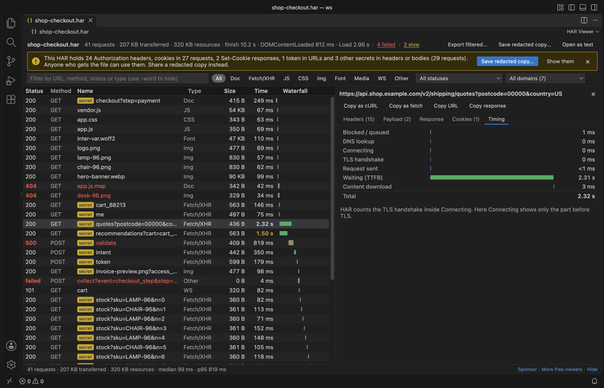
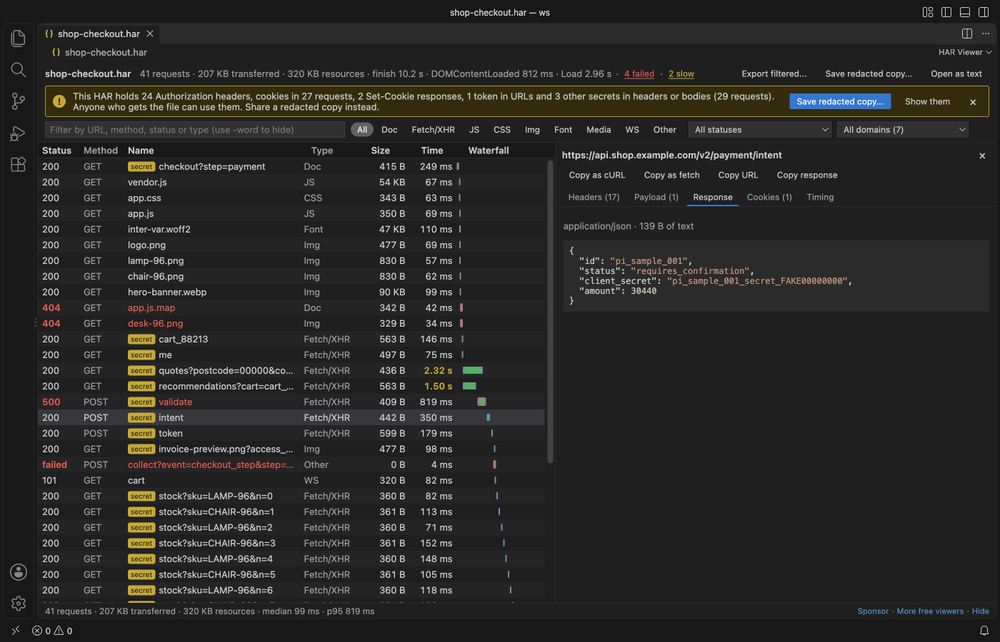
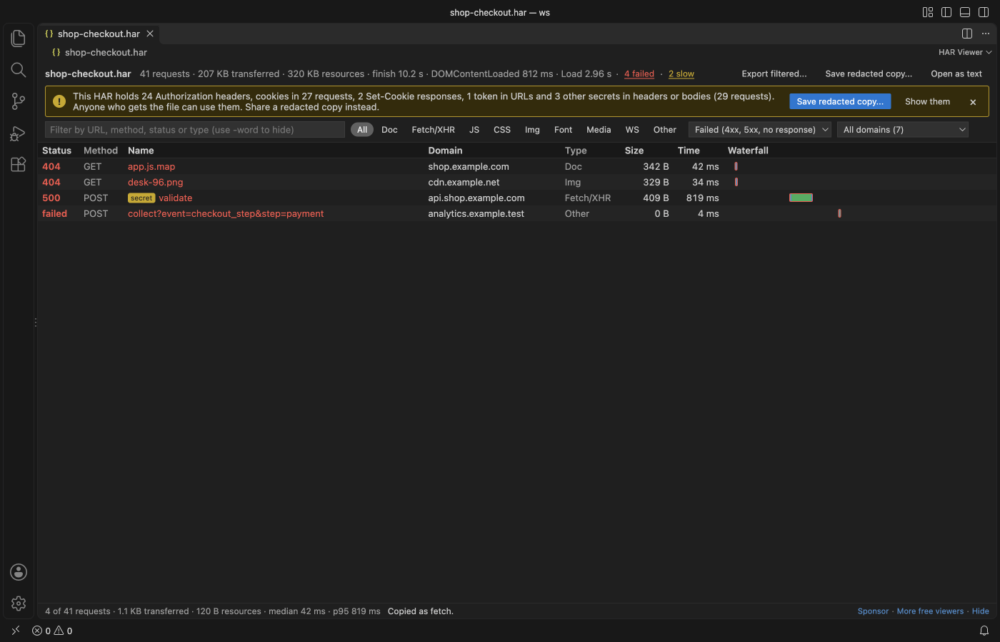
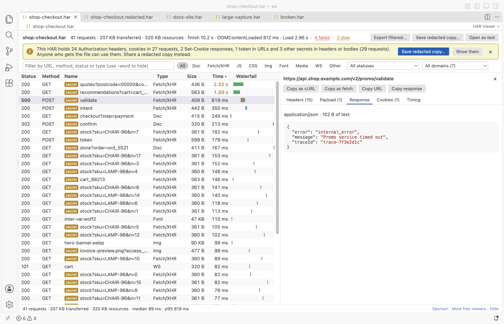
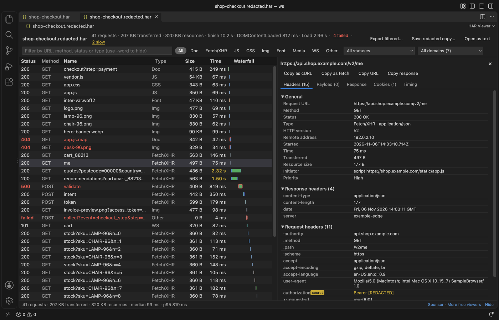

# HAR Viewer & HAR File Analyzer (HTTP Archive)

Open a .har file from browser DevTools in VS Code and see every request in a table with a timing waterfall, then copy any call as cURL or save a redacted copy that is safe to share.

The screenshot is a real VS Code 1.142 window running this extension on `shop-checkout.har`, a sample made by `scripts/make-samples.js` with fake hosts and fake tokens.

- See where the time went. Each row has a waterfall bar split into DNS, connect, TLS, waiting and download, and the summary counts failed and slow requests so you can jump straight to them.
- Read the whole exchange. Request and response headers, query string, payload, cookies and the response body, with JSON pretty-printed, form fields as a table and images shown inline.
- Share without leaking a session. A banner warns when the file holds Authorization headers, cookies or tokens, and one click writes a copy with those values replaced by `[REDACTED]`.

## Quick start

1. In Chrome, Edge or Firefox open DevTools, go to the Network tab and choose "Save all as HAR" (Safari calls it "Export HAR").
2. Click the .har file in the VS Code Explorer. It opens in HAR Viewer.

## What you can do

| Task | How |
|---|---|
| Find failed requests | Click "4 failed" in the summary, or pick Failed in the status list. Failed means 4xx, 5xx or no response at all. |
| Find slow requests | Click the slow count, or sort by Time. The limit is `harViewer.slowRequestMs` (1,000 ms by default). |
| Filter | Type buttons (Doc, Fetch/XHR, JS, CSS, Img, Font, Media, WS, Other), status, domain and a text box. `api -stock` keeps rows with "api" and hides rows with "stock". |
| Inspect one request | Click a row. Tabs show Headers, Payload, Response, Cookies and Timing. Arrow keys move through the rows and Escape closes the pane. |
| Reproduce a call | Copy as cURL or Copy as fetch, the same way DevTools does it. Copy URL and Copy response are next to them. |
| Keep only some requests | Filter the table, then "Export filtered..." writes those requests to a new HAR. |
| Share a capture | "Save redacted copy..." in the banner, or the command "HAR Viewer: Save a Redacted Copy", or right-click a .har in the Explorer. |

## What the redacted copy changes

- Authorization, Proxy-Authorization, API key, CSRF and similar headers become `[REDACTED]`. The `Bearer` or `Basic` word stays so you can still see the scheme.
- Cookie and Set-Cookie headers keep the cookie names and attributes, with each value replaced. The cookie lists in the HAR get the same treatment.
- Query, form and JSON fields with names such as `access_token`, `refresh_token`, `password`, `client_secret`, `api_key` or `session_id`, and any JWT, are replaced in URLs, request bodies and text response bodies.
- The original file is never changed, and a save over it is refused. A clean copy opens without the warning.

The rules are name-based. A secret stored under an unusual field name, or inside a binary body, is not found, so read the copy before you send it.

## Large files

A HAR is one JSON document, so it is read whole. In the release test a 47 MB capture with 30,000 requests showed its first rows in 0.8 seconds and all rows in under 1 second, a status filter over all 30,000 took about 0.2 seconds, and the rest of VS Code never waited more than 30 ms. Only the visible rows are drawn, so scrolling stays smooth. Files above `harViewer.maxFileMB` (300 MB by default) show a message instead of loading. Bodies longer than `harViewer.maxBodyKB` are cut in the details pane, and Copy still copies the full text.

## Settings

| Setting | Default | What it does |
|---|---|---|
| `harViewer.maxFileMB` | 300 | Largest HAR that is opened |
| `harViewer.slowRequestMs` | 1000 | Time at which a request counts as slow |
| `harViewer.maxBodyKB` | 1024 | Longest body shown in the details pane |
| `harViewer.askForRating` | true | Ask one time for a rating after a few days of use |
| `harViewer.showSupportLinks` | true | Show the small Sponsor and More free viewers links in the status line |

## Privacy

HAR Viewer works offline. It makes no network calls and sends no telemetry. The webview runs under a strict Content Security Policy with no remote scripts, images in a HAR are shown from the file itself, and every value from the file is shown as text, never as HTML.

## Known limits

- The viewer is read-only. Edit the JSON with "Open as text" if you need to.
- WebSocket frames (`_webSocketMessages`) are not listed yet. The upgrade request shows as a WS row.
- Pages are not grouped. The summary uses the timings of the first page in the file.
- Redaction is pattern-based, as described above.

## Support Zovo

Zovo extensions are free, with no ads and no tracking. They are made by [theluckystrike](https://github.com/theluckystrike) on GitHub. If this one saves you time, you can support the work:

- [Sponsor on GitHub](https://github.com/sponsors/theluckystrike)
- [Follow theluckystrike on GitHub](https://github.com/theluckystrike)

## More tools by Zovo

- [Large JSON Viewer, JSON Browser & JSON Tree](https://marketplace.visualstudio.com/items?itemName=zovo.zovo-json-tree-viewer) shows large JSON files as a searchable tree, copies JSONPath and turns arrays of objects into a table.
- [JSONL Viewer, Large JSONL Table & NDJSON Viewer](https://marketplace.visualstudio.com/items?itemName=zovo.zovo-jsonl-viewer) opens JSONL and NDJSON files as a table, as records or as a chat view.
- [SQLite Viewer & DB Viewer, Database Viewer (Read-Only)](https://marketplace.visualstudio.com/items?itemName=zovo.sqlite-table-viewer) browses SQLite tables read-only and runs SELECT queries.
- [Claude Code History & Codex History Viewer](https://marketplace.visualstudio.com/items?itemName=zovo.agent-session-viewer) browses and searches your local Claude Code and Codex sessions.
- [Graphviz Viewer & DOT Viewer (Live Preview)](https://marketplace.visualstudio.com/items?itemName=zovo.zovo-graphviz-preview) shows a live preview of DOT files and exports SVG or PNG.

See [all Zovo extensions on the Marketplace](https://marketplace.visualstudio.com/publishers/zovo).

## License

MIT

## More from zovo

- [All free zovo VS Code extensions](https://marketplace.visualstudio.com/publishers/zovo) — file viewers, database clients, formatters. Offline, no telemetry, no sign-up.
- [Full MCP server catalogue](https://theluckystrike.github.io/mcp/) — local-first MCP servers for back-office work: invoices, VAT, PDFs, spreadsheets, payroll.
- [Hosted no-install MCP endpoints](https://mcp.zovo.one) — paste a URL in Claude / Cursor, nothing to install.
